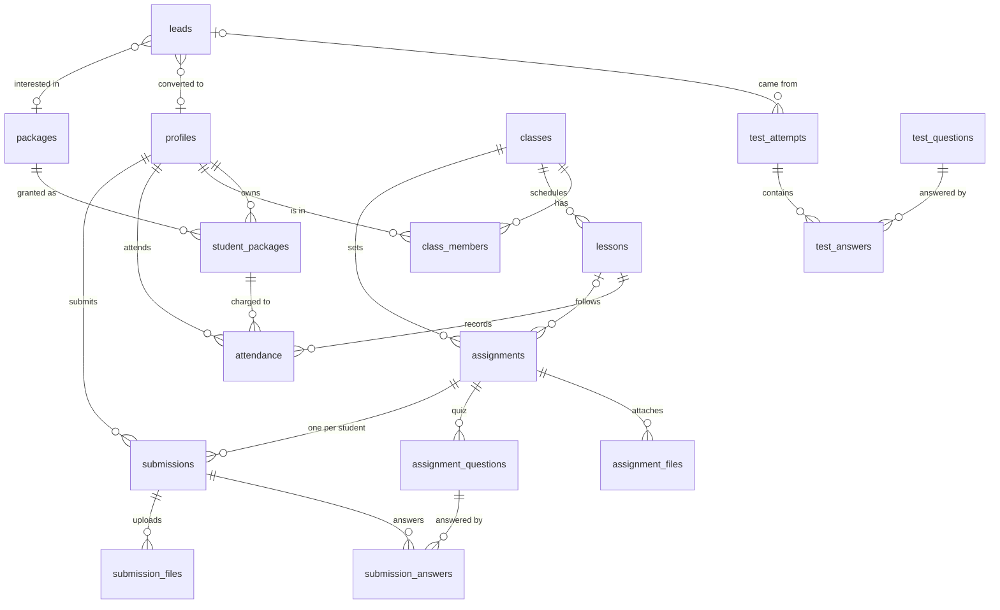

# Database schema (draft)

Full DDL: [schema.sql](schema.sql). Scenarios that use it: [user-scenarios.md](user-scenarios.md).

## Areas

| Area | Tables | Phase |
|---|---|---|
| People | `profiles`, `leads` | 1 |
| Level test | `test_questions`, `test_attempts`, `test_answers` | 2 |
| Classes | `classes`, `class_members` (3), `lessons`, `attendance` (5) | 3, 5 |
| Homework | `assignments`, `assignment_files`, `assignment_questions`, `submissions`, `submission_answers`, `submission_files` | 4 |
| Packages & credits | `packages` (1, display only), `student_packages` (5) | 1, 5 |
| Notifications | `email_log` | 4 |
| Payments | *(later: `payments`, `webhook_events`)* | 6 |

## Design decisions to review

1. **One teacher.** There's no `teacher_id` on classes, since you're the only teacher. `role = 'teacher'` grants full access. If you hire someone later, add `classes.teacher_id` and narrow the policies.
2. **Submission rows are created when homework is published**, one per class member, with status `assigned`. "Who hasn't submitted" is then a simple query, not a join against missing rows.
3. **One submission row per student per assignment.** A resubmit bumps `attempt`; files keep their `attempt` number so old versions survive. If you want full history of answers and feedback per attempt, split this into `submissions` + `submission_attempts`.
4. **Credits are a wallet** (`student_packages`), charged through `attendance.student_package_id`. You can always trace which lesson used which credit. `lessons_total` is copied at grant time, so editing a package never changes what a student already owns.
5. **Payments deferred:** `student_packages.source = 'manual'` plus a `note` ("paid cash 12 Nov") covers you until then. Payments later only adds rows with `source = 'payment'`.
6. **Visitors never write to tables directly.** The contact form and level test go through server actions using the service role. Quiz answers are hidden from students by a view with no `correct_answer`.
7. **Money in minor units** (`price_amount` in cents), so there are no float rounding issues.
8. **`email_log.dedupe_key`** makes the reminder cron safe to run again and again.
9. **Bilingual (fa / en):**
   - Only content you write once for everyone is stored in both languages: `packages.title`, `packages.description` and `packages.features`. These use the `i18n_text` type, `{"en","fa"}`, and both keys are required.
   - Things written for one person stay in the language they were written in: homework, feedback, notes, messages.
   - Level-test questions are always English (it's an English test); only the instructions around them are translated, and those live in code.
   - `locale` on `profiles`, `leads`, `test_attempts` and `email_log` decides the language of the UI and of emails. It defaults to `fa`.
   - UI strings live in `messages/en.json` and `messages/fa.json`, not in the database.
